# PDF Translator for macOS

PDF Translator is a desktop client for translating searchable PDFs and reviewing the results in the same window. This source preview covers version 2.10.2, build 11. The original prototype used [PDFMathTranslate-next 2.10.2](https://github.com/PDFMathTranslate-next/PDFMathTranslate-next/releases/tag/v2.10.2). The desktop client uses AppKit, WebKit, a Rust backend, and native components from [BabelDOC 0.7.1](https://github.com/funstory-ai/BabelDOC/tree/d922e2b0c5a353bde8731921eb442c07ae75849d).

## Feature screenshots

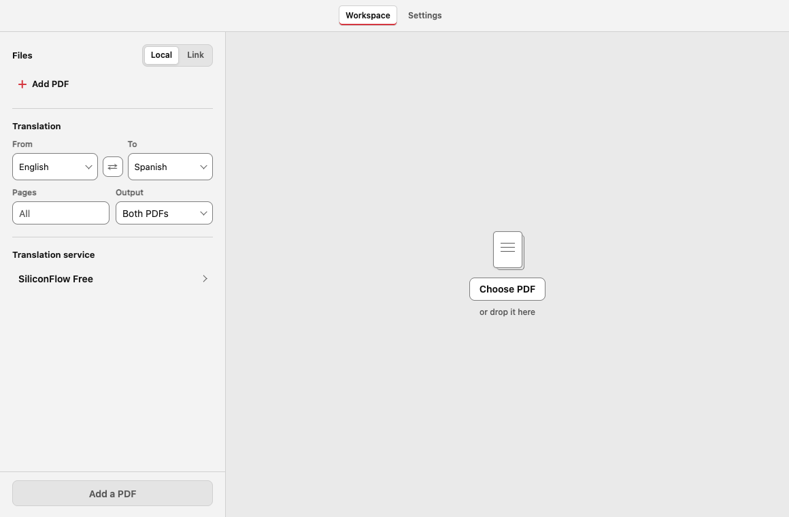

The gallery uses synthetic PDFs and a neutral background. Service, progress, and recovery examples use simulated responses.

### Workspace

| Link import | Page ranges and inline menus |
| --- | --- |
| 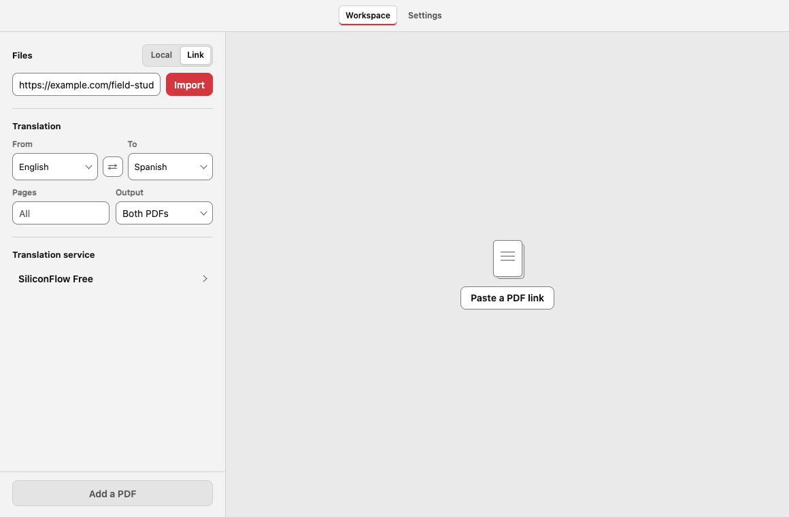 | 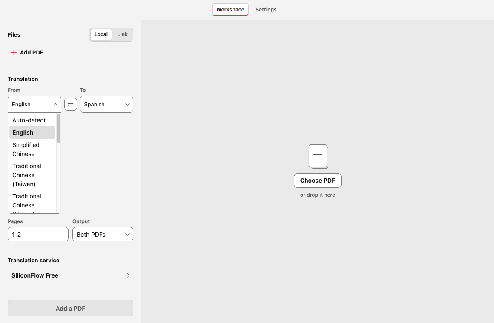 |
| Paste a direct PDF URL and choose **Import**. | Enter pages such as `2,5,9-12` and select the output format. Menus expand in place. |

| PDF preview and downloads | Compact workspace |
| --- | --- |
| 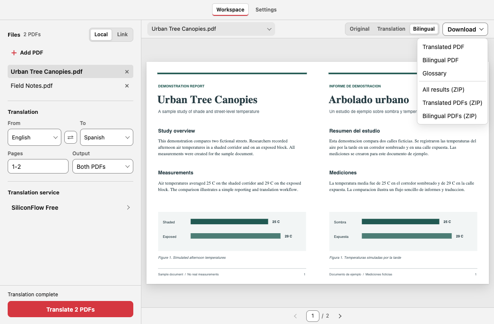 | 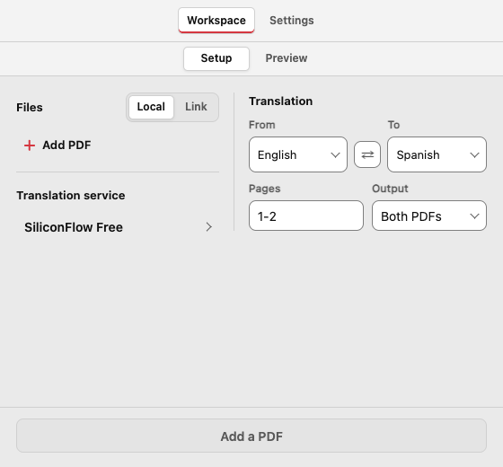 |
| Switch between the original, translated, and bilingual PDF. Download individual results or a batch ZIP when available. | Switch between **Setup** and **Preview** when the window is narrow. |

### Translation status

| Progress | Export with retained source text |
| --- | --- |
| 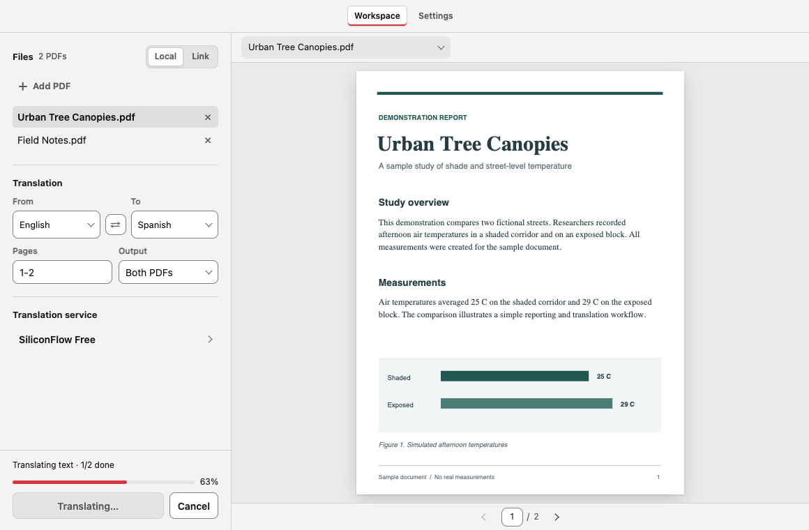 | 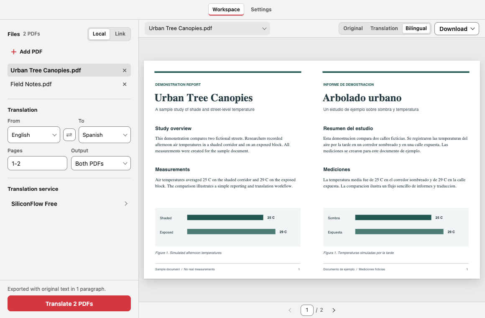 |
| The action bar shows progress and offers **Cancel**. | The result stays downloadable and the warning gives the affected paragraph count. |

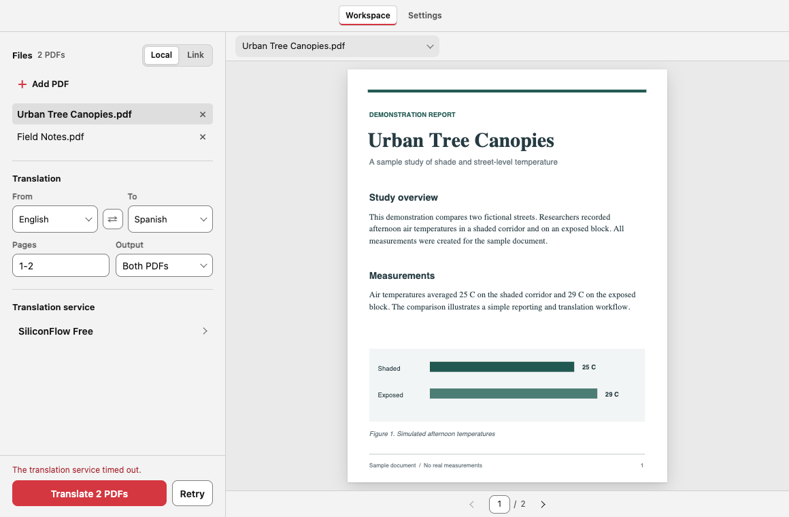

After a failed or canceled job, **Retry** starts the remaining work again.

### Settings

| Services | Model preset |
| --- | --- |
| 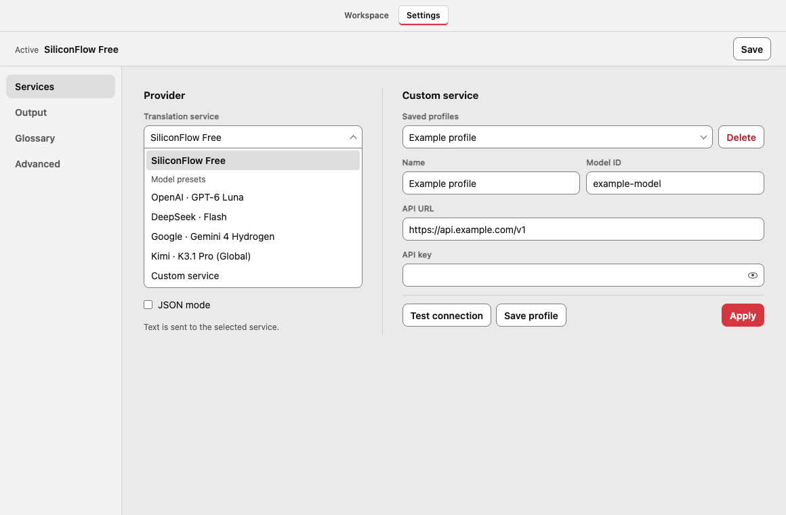 | 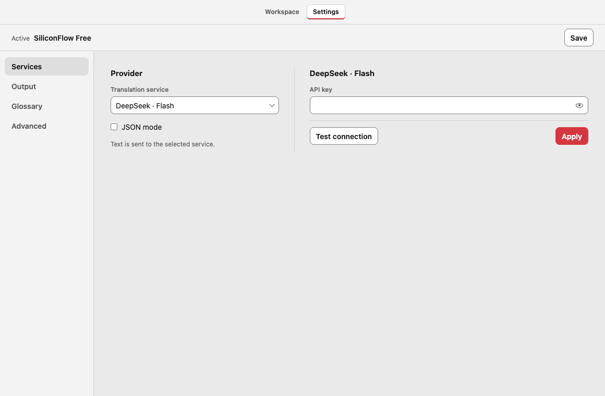 |
| Select SiliconFlow Free, choose a preset, or configure an OpenAI-compatible endpoint. | A preset fills the endpoint and model so you can enter a key and apply it. |

| Output | Glossary |
| --- | --- |
| 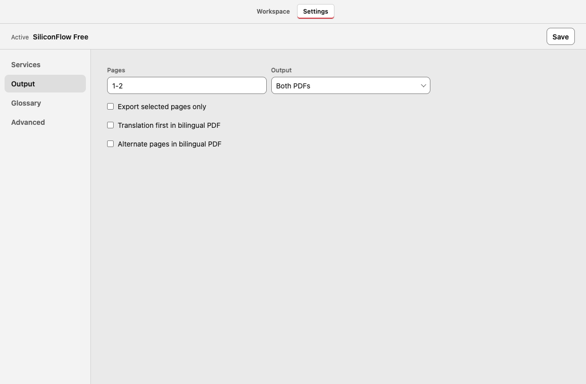 | 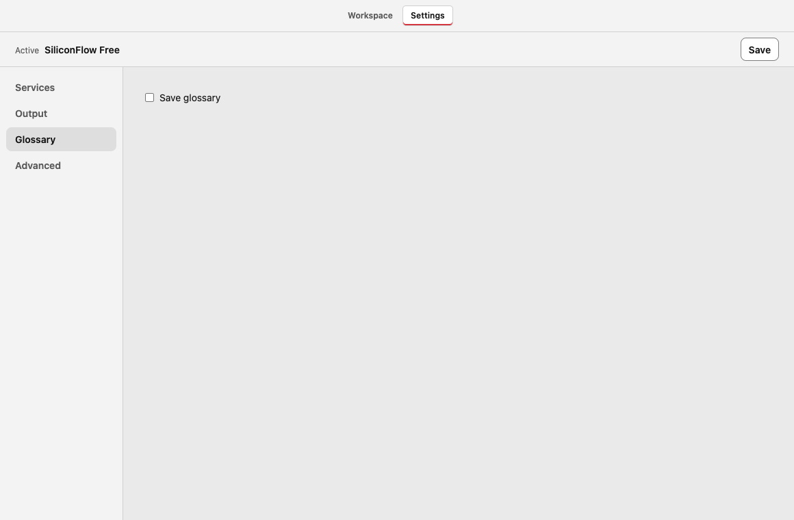 |
| Choose the pages to export and the bilingual page order. | Save the automatically extracted terminology as CSV. |

| Advanced |
| --- |
| 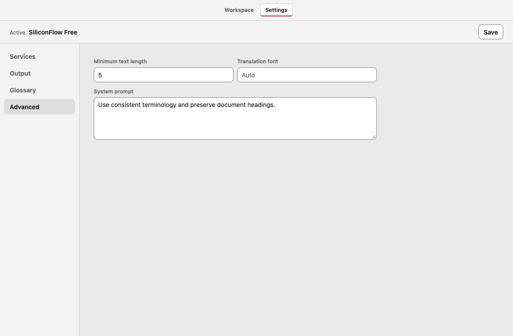 |
| Set the minimum text length, font preference, and system prompt for compatible services. |

## UI design

- **Two views.** The top bar centers **Workspace** and **Settings**. The workbench pairs a light gray frame and narrow configuration column with a larger document preview. The action bar keeps task feedback next to the Translate button.
- **Controls in place.** Pickers expand within their sections. The **Pages** field is visible by default and stays synchronized between Workspace and Settings. Page numbers start at 1. A blank field selects all pages.
- **Review in one window.** The embedded PDF.js viewer provides page navigation and version switching. Local files and links have separate queues. The active queue can be translated as a batch. A failed or canceled job offers **Retry**.
- **Settings by task.** Services, Output, Glossary, and Advanced each have their own panel. Labels and feedback use concise English. Optional packaged artwork appears only in the empty preview and rotates when the workspace opens.

## Compared with PDFMathTranslate-next 2.10.2

The comparison uses the 2.10.2 release as its baseline. The upstream WebUI already supports PDF preview, custom ranges, layout preservation, and bilingual export.

| Area | Upstream 2.10.2 | macOS client |
| --- | --- | --- |
| Platform | Python CLI and Gradio WebUI, with documented Windows, Docker, and macOS installation routes. | AppKit/WebKit window with a Rust backend, native file picking, and native downloads. The package was verified on Apple Silicon. |
| Page selection | Presets for all pages, the first page, and the first five pages, plus a custom range option. | The range field is immediately editable. It accepts single pages and mixed selections such as `1` and `2,5,9-12`. |
| Review and export | PDF preview, batch ZIPs, translated and bilingual PDFs, selected-page output, and terminology options. | These workflows share the desktop window. The preview switches between the original and available outputs, and downloads follow the current file. |
| Document structure | BabelDOC-based layout and formula preservation. | Native BabelDOC processing retains formatting and formula markers where available. Recognized abstracts, keywords, and references stay in the source language. Section detection is heuristic. |
| Incomplete responses | Python translation workflow and provider handling. | Length-limit errors and strongly suspicious short replies trigger bounded retries for the affected paragraph. The client splits that paragraph, keeps completed fragments, and reports retained source text if recovery falls short. |
| Services | A broader catalogue of provider-specific adapters and configuration options. | SiliconFlow Free and OpenAI-compatible APIs, with model presets and reusable custom profiles. Availability and response time depend on the selected provider. |
| Advanced options | OCR workaround flags, watermark options, document splitting, formula and table controls, Python automation, and glossary import. | Text PDFs and a smaller settings surface. The desktop client lacks built-in OCR, custom glossary import, and the upstream CLI, Python API, Docker, and provider-specific controls. |

## Design trade-offs and current limits

- **Searchable text first.** Image-only scans need OCR before translation. PDF extraction, rendering, and layout run locally. The selected translation service receives extracted text.
- **Inline menus use layout space.** Opening the Output menu can temporarily stretch the adjacent Pages field.
- **Keep readable output when a reply fails.** Recovery uses a limited number of paragraph splits. If a provider omits its completion status, a plausible-looking partial reply can still pass the checks. Recognized sections and recovery fallbacks can leave source text in a translated PDF.
- **Keep service setup small.** **Save profile** stores the name, endpoint, and model. The separate **Save** action persists the active configuration, which can include its API key in local settings. JSON mode applies to glossary extraction. Custom compatible services can use a system prompt for paragraph translation.
- **Keep packaging predictable.** The current build targets Apple Silicon. Its bundled ONNX Runtime requires macOS 14 or later. The port replaces the Python/Gradio runtime with a local desktop stack. Translation time still varies with the provider and its retries.

## Build and run locally

From a checkout of this branch, build on macOS with Rust 1.89 or later and the macOS SDK.

```sh
cd desktop/macos
cargo build --release --locked
```

Run against the resources from the matching locally installed app.

```sh
HERMENEUEIN_RESOURCES="/path/to/PDF Translator.app/Contents/Resources" \
HERMENEUEIN_DATA="$(mktemp -d)" \
  ./target/release/hermeneuein
```

The runtime resource directory contains `web/`, `models/`, and `fonts/`. The matching fonts, layout model, and ONNX Runtime library are listed in `packaging/runtime-assets.sha256`. The workbench and its PDF.js dependency are in `web/`. The macOS bundle metadata is in `packaging/Info.plist`.

## Source and distribution

This preview contains source, dependency notices, the PDF.js distribution, and runtime checksums. A runnable package also needs the matching runtime resources. The local binary and optional film-inspired artwork are outside the public preview. Vendored BabelDOC source and its license are in `vendor/babeldoc/`. The local build's dependency notices are in `upstream-notices/`.
